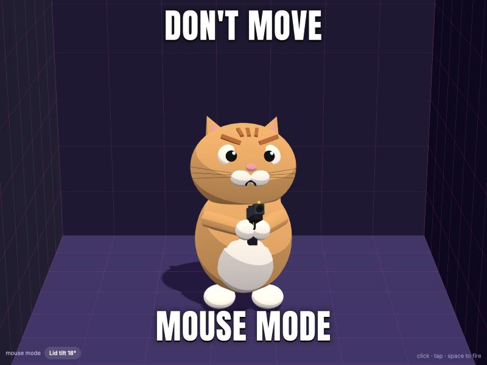
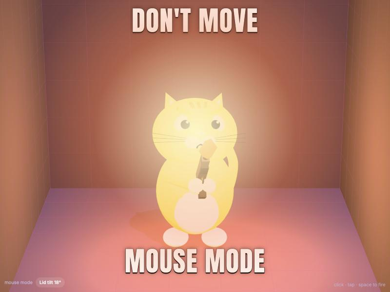
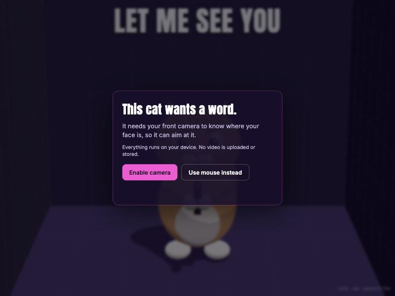
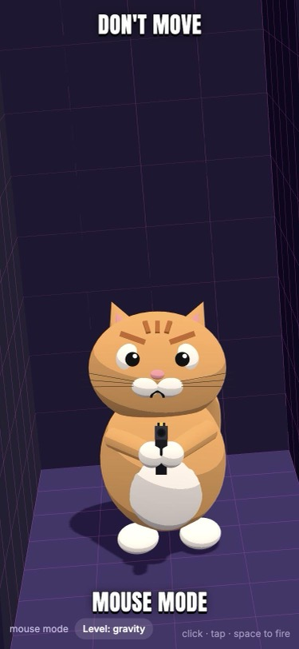

# Cat Aims At You

A 3D cartoon cat that tracks your face through the front camera and keeps its gun pointed at you.

**Live:** https://alexgoexercise.github.io/cat-aims-at-you/

<p>
  
  
</p>
<p>
  
  
</p>

## Features

- **Face tracking** – MediaPipe Face Landmarker estimates where your eyes are in 3D, in meters.
- **Window effect** – head-coupled perspective makes the screen behave like a window into a small room.
- **Copies your face** – winks, yawns, smiles, raised or lowered brows, puffed cheeks, kiss faces and head tilts are mirrored on the cat, with a meme caption for some (`src/mimic.js`).
- **Poke the cat** – click its head, nose, ears, belly, tail, gun or feet for different reactions. Booping the nose makes it sneeze, and the gun goes off.
- **Level floor** – the room's floor stays horizontal in the real world: at keyboard height on laptops, and level with the horizon on phones.
- **Private** – runs entirely in the browser. Video never leaves the device.
- **No build step** – plain HTML and ES modules, with Three.js and MediaPipe loaded from a CDN.

Blink to fire. Both eyes have to close, so winks are ignored (`src/blink.js`). Without the camera, mouse mode fires with a click, a tap or the space bar.

## Run locally

```bash
python3 -m http.server 5173
```

Open http://localhost:5173. The camera needs HTTPS or `localhost`, so use the deployed site or a tunnel to test on a phone.

## How it works

| | File | |
| --- | --- | --- |
| Tracking | `src/tracker.js` | Distance from apparent iris spacing (`z = f · 6.3 cm / ipd_px`), then back-projection through a pinhole camera model. |
| Smoothing | `src/filter.js` | One-euro filter: steady when you're still, responsive when you move. |
| Projection | `src/main.js` | Off-axis frustum from your eye position through the physical screen edges. |
| Level | `src/level.js` | Phones use the gravity sensor. Laptops use the lid's motion sensor if there is one, or estimate the lid tilt from head pose. |
| Room | `src/room.js` | Built in gravity space and clipped at the screen plane. |
| Cat | `src/cat.js` | Built from primitives. The head and gun `lookAt()` your eye position. |

Browsers can't read a laptop's hinge angle, and MacBooks have no accelerometer, so on most laptops the lid tilt is an estimate. Set it by hand in the **Lid tilt** panel (bottom left), or with `?tilt=`.

## Configuration

URL parameters, with defaults in `src/config.js`:

| Param | Default | |
| --- | --- | --- |
| `fov` | `72` desktop / `78` phone | Webcam diagonal field of view, in degrees |
| `mpp` | `0.00021` / `0.00018` | Meters per CSS pixel (physical screen size) |
| `dist` | `0.55` / `0.35` | Viewing distance in meters when no face is tracked |
| `tilt` | auto | Laptop lid tilt in degrees from vertical |
| `parallax` | `1` | `0` turns off the window effect |

## Deploy

GitHub Pages serves the repo root from `main`. Any push to `main` redeploys.
